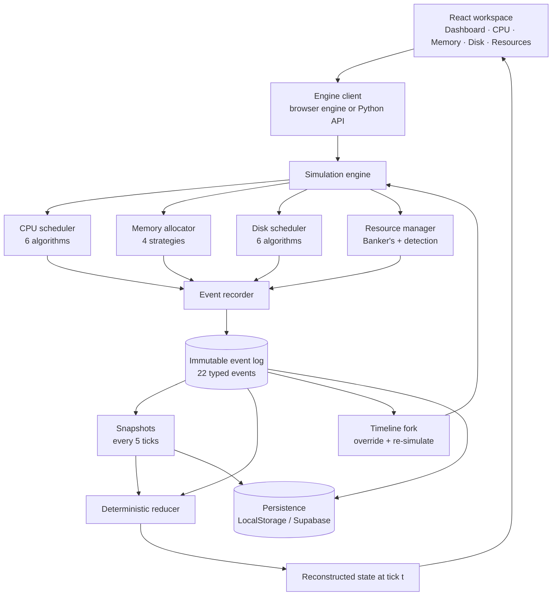

<div align="center">

# ChronoOS

**A time-travel operating system simulator**  
CPU scheduling · Memory allocation · Disk scheduling · Deadlock analysis

[](https://react.dev)
[](https://www.typescriptlang.org)
[](https://vite.dev)
[](https://tailwindcss.com)
[](https://www.python.org)
[](#testing--validation)


</div>

**ChronoOS** is a browser-first operating system simulator that records every scheduling, allocation and resource decision as an immutable event. Instead of showing only the final Gantt chart or memory map, it lets you **rewind to any tick, reconstruct the exact kernel state, and fork an alternative timeline** to compare strategies side by side.

Built as a B.Tech Computer Science & Engineering minor project at **K.R. Mangalam University** (2026–2027).

---

## Table of contents

- [Why ChronoOS](#why-chronoos)
- [Features](#features)
- [Screenshots](#screenshots)
- [Tech stack](#tech-stack)
- [Architecture](#architecture)
- [How time travel works](#how-time-travel-works)
- [Supported algorithms](#supported-algorithms)
- [Getting started](#getting-started)
- [Configuration](#configuration)
- [Optional Python engine](#optional-python-engine)
- [Optional Supabase persistence](#optional-supabase-persistence)
- [Usage walkthrough](#usage-walkthrough)
- [Project structure](#project-structure)
- [Testing & validation](#testing--validation)
- [Engine API](#engine-api)
- [Deployment](#deployment)
- [Presentation & documentation](#presentation--documentation)
- [Roadmap](#roadmap)
- [Team](#team)
- [License](#license)

---

## Why ChronoOS

Operating-system behaviour emerges from interactions between processes, memory, CPU and shared resources. Most teaching tools display the outcome of a run but discard the path that produced it.

| Conventional simulator | ChronoOS |
|---|---|
| Shows the final Gantt chart or memory map | Keeps the complete transition history |
| Restart required to try another algorithm | Fork from any tick and compare both runs |
| CPU, memory, disk and deadlock taught in isolation | One integrated kernel model |
| Raw metrics only | Automated, plain-language forensic findings |
| Usually cloud-dependent | Local-first and fully usable offline |

ChronoOS treats **execution history as a first-class product**, not as a debugging afterthought.

---

## Features

### Four simulation domains

- **CPU scheduling** — FCFS, SJF, SRTF, preemptive priority, non-preemptive priority and Round Robin with a configurable quantum.
- **Memory management** — First Fit, Best Fit, Worst Fit and Next Fit with dynamic allocation, waiting, coalescing and fragmentation analysis.
- **Disk scheduling** — FCFS, SSTF, SCAN, C-SCAN, LOOK and C-LOOK with head-movement visualisation.
- **Deadlock management** — Banker's Algorithm for avoidance plus wait-for-cycle detection, with safe-sequence reporting.

### Event-sourced time travel

- 22 typed event variants covering process, CPU, memory, disk and resource transitions.
- Canonical event ordering by timestamp and emission sequence.
- A pure reducer rebuilds state from the log.
- Snapshots every 5 ticks by default keep reconstruction fast.
- The timeline scrubber and playback controls update every workspace in sync.

### Timeline forking

- Fork from any historical tick without modifying the original run.
- Override the CPU algorithm, quantum, memory strategy or disk algorithm.
- Only affected domains are re-simulated; the rest of the history is preserved.
- Branch metadata records the parent, base timestamp and base sequence.
- Side-by-side comparison of waiting time, turnaround time, CPU utilisation and more.

### Analytics and forensics

- CPU utilisation, throughput, average waiting, turnaround, response time and context switches.
- Memory used, free, largest contiguous hole and external fragmentation percentage.
- Disk head movement, average latency and maximum request latency.
- Findings graded `info`, `warning` or `critical`, explaining fragmentation failures, unsafe requests, starvation and deadlocks.

### Engineering quality

- Deterministic engine with **cross-language parity tests** between the TypeScript and Python implementations.
- 25 frontend tests and 32 backend tests, all passing.
- Zero TypeScript errors and zero ESLint errors.
- Local-first persistence with optional Supabase synchronisation.
- Offline-capable: no backend or account is required for the default experience.

---

## Screenshots

<table>
  <tr>
    <td width="50%">
      
      <br />
      <sub><b>Overview</b> — the recorded run, live state and headline metrics.</sub>
    </td>
    <td width="50%">
      
      <br />
      <sub><b>Time machine</b> — scrub the timeline and inspect the reconstructed state.</sub>
    </td>
  </tr>
  <tr>
    <td width="50%">
      
      <br />
      <sub><b>CPU workspace</b> — Gantt chart, queue state and scheduling metrics.</sub>
    </td>
    <td width="50%">
      
      <br />
      <sub><b>Memory workspace</b> — allocation map, holes and fragmentation.</sub>
    </td>
  </tr>
  <tr>
    <td width="50%">
      
      <br />
      <sub><b>Disk workspace</b> — head trajectory and per-request latency.</sub>
    </td>
    <td width="50%">
      
      <br />
      <sub><b>Branches</b> — fork a run and compare alternative strategies.</sub>
    </td>
  </tr>
  <tr>
    <td width="50%">
      
      <br />
      <sub><b>Forensics</b> — raw events translated into readable findings.</sub>
    </td>
    <td width="50%">
      
      <br />
      <sub><b>Configurator</b> — processes, algorithms, quantum and disk geometry.</sub>
    </td>
  </tr>
  <tr>
    <td width="50%">
      
      <br />
      <sub><b>Resources</b> — Banker's safe sequence and deadlock detection.</sub>
    </td>
    <td width="50%">
      
      <br />
      <sub><b>Kernel logs</b> — the immutable event stream behind every view.</sub>
    </td>
  </tr>
</table>

---

## Tech stack

| Layer | Technology | Purpose |
|---|---|---|
| UI | React 18 | Component-based workspace and dashboard |
| Language | TypeScript 5 | Type-safe simulation and persistence code |
| Build | Vite 7 | Development server and production bundling |
| Styling | Tailwind CSS 3 | Design system and responsive layout |
| Routing | React Router 7 | Dashboard and per-simulation workspaces |
| Charts | Recharts 3 | Gantt charts and performance visualisation |
| Icons | Lucide React | Consistent interface iconography |
| Testing | Vitest 3 | Engine, parity and persistence tests |
| Persistence | LocalStorage | Default, offline-first storage |
| Cloud (optional) | Supabase | PostgreSQL persistence with row-level security |
| Engine (optional) | Python 3.10+ | Standard-library HTTP API mirroring the engine |

---

## Architecture



**Execution pipeline**

```text
Configuration
  → Simulation engine (CPU → memory → disk → resources)
  → Event recorder
  → Canonical, append-only event log
  → Snapshots at fixed intervals
  → Deterministic reducer
  → Reconstructed state for the selected tick
  → Dashboard, workspaces and forensics
```

The event log is the single source of truth. Every other view — Gantt chart, memory map, metrics, findings — is derived from it.

---

## How time travel works

### 1. Record every transition

Each significant operation is appended as a typed event. Events carry a timestamp, sequence number, optional process/resource identifier, a JSON payload and a human-readable description.

```ts
interface ChronoEvent {
  seq: number;                 // canonical position in the log
  type: EventType;             // one of 22 variants
  timestamp: number;
  processId: string | null;
  resourceId: string | null;
  payload: Record<string, unknown>;
  description: string;
}
```

### 2. Reconstruct any tick

Rather than replaying the entire history, ChronoOS loads the newest snapshot at or before the target tick and replays only the remaining events through the pure reducer.

```text
state(T) = fold(reducer, nearestSnapshot(T).state, events after snapshot up to T)
```

With a 5-tick snapshot interval, a reconstruction never replays more than one interval of events.

### 3. Fork an alternative timeline

A fork copies the parent's events up to the chosen tick, applies the requested algorithm overrides, and re-simulates only the affected domains. The original log is never modified.

```text
branch = parent events ≤ T + re-simulated events for changed domains
```

This makes controlled comparisons possible: change the scheduler at tick 12 and compare both realities without losing the original run.

---

## Supported algorithms

| Domain | Algorithms | Count |
|---|---|---|
| CPU scheduling | FCFS, SJF, SRTF, Priority (preemptive), Priority (non-preemptive), Round Robin | 6 |
| Memory allocation | First Fit, Best Fit, Worst Fit, Next Fit | 4 |
| Disk scheduling | FCFS, SSTF, SCAN, C-SCAN, LOOK, C-LOOK | 6 |
| **Total variants** | | **16** |

Deadlock handling is provided by **Banker's Algorithm** (avoidance and safe-state analysis) and **wait-for-cycle detection**, configured through resource types, maximum claims and a request/release script.

---

## Getting started

### Prerequisites

| Requirement | Version |
|---|---|
| Node.js | 20.19+ (Vite 7 requirement; 22 LTS recommended) |
| npm | 10+ |
| Python | 3.10+ — only for the optional backend engine and its tests |

### Install and run

From the project root:

```bash
# 1. Install frontend dependencies
npm install

# 2. Start the development server
npm run dev
```

Open **http://localhost:5173**.

The application runs entirely in the browser by default. No database, no backend and no environment variables are required.

### Available scripts

| Command | Description |
|---|---|
| `npm run dev` | Start the Vite development server |
| `npm run build` | Create a production build in `dist/` |
| `npm run preview` | Preview the production build locally |
| `npm run typecheck` | Run TypeScript with no emit |
| `npm run lint` | Run ESLint over the repository |
| `npx vitest run` | Run the frontend and engine test suites |

---

## Configuration

Copy `.env.example` to `.env` only when you need the optional services. The `.env` file is git-ignored.

```bash
cp .env.example .env
```

| Variable | Default | Purpose |
|---|---|---|
| `VITE_SUPABASE_ENABLED` | `false` | Enable Supabase persistence |
| `VITE_SUPABASE_URL` | — | Supabase project URL |
| `VITE_SUPABASE_ANON_KEY` | — | Supabase anonymous key |
| `VITE_ENGINE_URL` | *(empty)* | Use the Python engine instead of the in-browser engine |
| `CHRONOOS_API_HOST` | `127.0.0.1` | Python engine bind host |
| `CHRONOOS_API_PORT` | `8787` | Python engine port |
| `CHRONOOS_LOG_LEVEL` | `INFO` | Python engine log level |

The default simulation configuration uses seed `42` and a snapshot interval of `5` ticks. Process definitions, CPU/memory/disk algorithms, quantum, memory size, disk geometry and resource scripts are editable from the configurator.

---

## Optional Python engine

The TypeScript engine is the default. A behaviourally identical Python implementation is included for validation, scripting and headless use. It uses only the Python standard library.

```bash
# Terminal 1 — start the engine
cd backend
python -m chronoos
# listening on http://127.0.0.1:8787

# Terminal 2 — point the frontend at it
# set VITE_ENGINE_URL=http://127.0.0.1:8787 in .env
npm run dev
```

Or start both processes together:

```powershell
# Windows
.\scripts\start.ps1
```

```bash
# macOS / Linux
./scripts/start.sh
```

Health check:

```bash
curl http://127.0.0.1:8787/api/health
# {"status":"ok","service":"chronoos-engine","version":"1.0.0"}
```

If `VITE_ENGINE_URL` is set but the service is unreachable, the client reports a clear error instead of silently falling back.

---

## Optional Supabase persistence

LocalStorage is the default and works offline. To persist simulations in PostgreSQL:

1. Create a Supabase project.
2. Run [`supabase/migrations/20261031121524_create_chronoos_schema.sql`](supabase/migrations/20261031121524_create_chronoos_schema.sql) in the Supabase SQL editor.
3. Set the Supabase variables in `.env`.
4. Restart the development server.

The schema creates four tables:

| Table | Contents |
|---|---|
| `chrono_simulations` | One row per simulation, with its full configuration |
| `chrono_branches` | Timelines and forks, including parent, base timestamp and base sequence |
| `chrono_events` | Immutable event rows with per-branch sequence numbers |
| `chrono_snapshots` | Serialised state snapshots for fast reconstruction |

On startup, the repository probes Supabase for four seconds. If it is unavailable or not configured, ChronoOS transparently keeps using LocalStorage, so a failed cloud connection never blocks a demo.

> **Note:** the migration enables row-level security but grants the anonymous role full CRUD access because the app has no sign-in screen. Treat this as a classroom/demo configuration, not a production multi-tenant deployment.

---

## Usage walkthrough

1. **Open the dashboard** — the simulation vault lists every recorded run and stores bookmarks locally.
2. **Launch a simulation** — configure processes, CPU algorithm and quantum, memory size and strategy, disk geometry and requests, then run it.
3. **Inspect CPU behaviour** — review the Gantt chart, ready queue, context switches and scheduling metrics.
4. **Inspect memory** — watch allocations, holes, waiting processes and fragmentation.
5. **Inspect disk and resources** — follow the head trajectory, request latencies, safe states and deadlock detection.
6. **Scrub the timeline** — move to any tick or press play; every workspace follows the reconstructed state.
7. **Fork a branch** — choose a tick, change an algorithm, re-simulate and compare the two timelines.
8. **Read the forensics** — open *Forensics* for plain-language findings and *Kernel Logs* for the raw event stream.

---

## Project structure

```text
ChronoOS/
├── src/
│   ├── engine/                  # Deterministic simulation core
│   │   ├── cpu/                 # 6 CPU scheduling algorithms
│   │   ├── memory/              # 4 contiguous allocation strategies
│   │   ├── disk/                # 6 disk scheduling algorithms
│   │   ├── resources/           # Banker's algorithm and deadlock detection
│   │   ├── events.ts            # 22 typed event variants
│   │   ├── recorder.ts          # Append-only event recorder
│   │   ├── reducer.ts           # Pure state reducer
│   │   ├── simulator.ts         # Run, reconstruct, fork and snapshot logic
│   │   ├── analytics.ts         # Scheduling and resource metrics
│   │   ├── forensics.ts         # Plain-language findings
│   │   └── __tests__/           # Engine and parity tests
│   ├── pages/                   # Dashboard, configurator and workspaces
│   │   └── simulation/          # CPU, memory, disk, resources, time, branches…
│   ├── components/              # App shell, timeline bar and UI primitives
│   ├── context/                 # Simulation state provider
│   ├── lib/                     # Persistence, engine client and Supabase adapter
│   └── App.tsx                  # Route definitions
├── backend/
│   ├── chronoos/                # Python mirror of the engine (stdlib only)
│   │   ├── engine/
│   │   ├── api.py               # Route handlers
│   │   └── server.py            # Threaded HTTP server
│   └── tests/                   # pytest suite
├── shared/parity/               # Golden cases shared by both engines
│   ├── cases.json
│   └── golden.json
├── supabase/migrations/         # PostgreSQL schema and RLS policies
├── scripts/                     # One-command launchers (PowerShell + Bash)
├── tools/parity/                # Golden-file generator
├── docs/screenshots/            # Screenshots used in this README
├── presentation/                # Academic deck and rendered slides
├── .env.example
├── index.html
└── package.json
```

---

## Testing & validation

```bash
# Frontend, engine and parity tests
npx vitest run

# Backend API, validation and parity tests
cd backend
python -m pytest

# Static checks
npm run typecheck
npm run lint
```

| Check | Result |
|---|---|
| Frontend / engine tests (Vitest) | **25 passed** across 3 files |
| Backend tests (pytest) | **32 passed**, 24 subtests |
| TypeScript | **0 errors** |
| ESLint | **0 errors**, 4 fast-refresh warnings |
| Production build | Succeeds (bundle-size warning only) |
| Snapshot reconstruction | Verified against expected states |
| Fork parity | Verified against parent history |

### Cross-engine parity

Both engines are validated against the same golden files in `shared/parity/`:

- `cases.json` defines six scenarios spanning FCFS, SJF, SRTF, priority, Round Robin, memory strategies and disk algorithms.
- `golden.json` stores the expected event log, analytics and forensic findings.
- The Vitest parity suite runs the TypeScript engine against the goldens.
- The pytest parity suite runs the Python engine against the same goldens.

Any divergence in event ordering, metrics or findings fails the build. This is how the two implementations stay behaviourally identical.

---

## Engine API

The optional Python service exposes a small JSON API. The browser engine implements the same operations locally.

| Method | Endpoint | Purpose |
|---|---|---|
| `GET` | `/api/health` | Service status and version |
| `GET` | `/api/presets/default` | Default simulation configuration |
| `POST` | `/api/simulations/run` | Run a simulation from a configuration |
| `POST` | `/api/logs/hydrate` | Rebuild a log from stored events and snapshots |
| `POST` | `/api/logs/analysis` | Compute analytics and forensic findings |
| `POST` | `/api/logs/reconstruct` | Reconstruct state at a given tick |
| `POST` | `/api/logs/fork` | Fork a timeline with algorithm overrides |

Example:

```bash
curl -X POST http://127.0.0.1:8787/api/simulations/run \
  -H "Content-Type: application/json" \
  -d '{"config": { ... }}'
```

Responses return either `{ "log": ..., "analysis": ... }` or `{ "state": ..., "time": ... }`. Validation failures return `400` with a `details` array, oversized bodies return `413`, and engine failures return `422`.

---

## Deployment

ChronoOS builds to static assets, so it can be hosted on any static platform.

```bash
npm run build
# output: dist/
```

1. Deploy the `dist/` directory.
2. Configure an SPA fallback so unknown routes rewrite to `index.html` (React Router uses browser history).
3. Set Supabase or engine variables at **build time** — Vite inlines `VITE_*` values.

The default build requires no server-side runtime. If you deploy the Python engine separately, set `VITE_ENGINE_URL` to its public URL and keep CORS in mind.

---

## Presentation & documentation

| Resource | Description |
|---|---|
| [`minor project .pptx`](minor%20project%20.pptx) | Final 15-slide academic presentation (4:3, university template) |
| [`presentation/ChronoOS-Presentation.pptx`](presentation/ChronoOS-Presentation.pptx) | Image-based 15-slide deck built from the rendered slides |
| [`presentation/preview/final/`](presentation/preview/final) | Rendered slide images (`slide01.png`–`slide15.png`) |
| [`presentation/make_ppt.py`](presentation/make_ppt.py) | Script that rebuilds the image-based deck |

---

## Roadmap

- [ ] Virtual memory and page-replacement algorithms
- [ ] File-system management and allocation strategies
- [ ] Semaphores, mutexes and inter-process synchronisation
- [ ] Network and packet-routing simulation
- [ ] PDF and CSV report export
- [ ] Collaborative simulation sessions
- [ ] Guided tutorial mode for first-time users
- [ ] Web Worker execution for larger simulations
- [ ] Code-splitting to reduce the production bundle size

---

## Team

**Team Code Blooded** — B.Tech Computer Science & Engineering, K.R. Mangalam University, 2026–2027

| Member |
|---|
| Piyush |
| Kunal |
| Ayush |
| Advitya |
| Sanyam |

### Acknowledgements

- Department of Computer Science & Engineering, K.R. Mangalam University
- Faculty mentor and project guide
- The open-source React, TypeScript, Vite, Tailwind CSS, Recharts and Supabase communities

---

## License

This repository is shared for **academic and educational use**. The code is provided as-is, without warranty. If you reuse it in your own work, please credit the team.

Third-party dependencies remain under their respective licenses.
